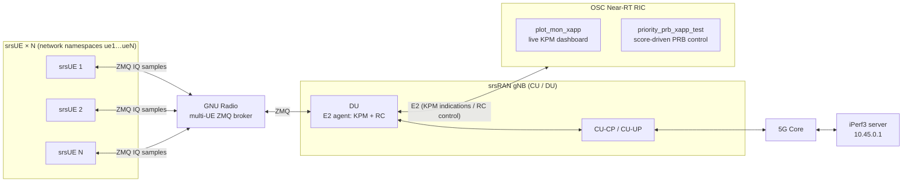

<div align="center">

# Priority-Aware PRB Allocation in O-RAN with srsRAN and the OSC Near-RT RIC

**MECT Master's Thesis: experimental workspace**


</div>

---

## 📖 Overview

In srsRAN, physical resource blocks (PRBs) are shared roughly equally among all active UEs, so when the cell is congested there is **no differentiation between users of different priority**.

This repository holds the testbed and experiments for a **closed-loop xApp** that runs on the O-RAN SC Near-RT RIC and fixes that. The xApp:

1. **Monitors** the cell through **E2SM-KPM**: DL PRB load (Style 1), plus per-UE DL throughput and RLC SDU delay (Style 4).
2. **Computes a continuous congestion score** in [0, 1] by combining PRB pressure, UE-competition pressure and delay pressure.
3. **Scales per-UE PRB caps continuously** with that score, gated by the delay pressure of higher-priority UEs, and enforces them through **E2SM-RC** *Slice-Level PRB Quota* control. As a result, **high**, **medium** and **best-effort** UEs get different shares of the cell.

The policy is evaluated against a **baseline** (no control) over a matrix of traffic scenarios, with 3 and 6 emulated UEs at 10 MHz and 20 MHz.

---

## 🏗️ Testbed Architecture



The full deployment diagrams are in [`Network_Topologies/`](Network_Topologies/) (`Deployment1`–`Deployment4`, as `.drawio` and `.png`).

---

## 🧠 Control Policy (`priority_prb_xapp_test.py`)

There are no on/off congestion thresholds. A **continuous congestion score** sets how aggressively lower-priority UEs are capped.

### 1. Congestion score

Each pressure term is normalised to [0, 1]:

| Pressure | Definition | KPM source |
|---|---|---|
| **PRB** | EMA-smoothed DL PRB load / 100 (α = 0.3) | `RRU.PrbTotDl` (fallback `PrbUsedDl`, `PrbAvailDl`) |
| **Competition** | `1 − 1/N`, where N is the number of active UEs (DL throughput ≥ 500 kbps) | `DRB.UEThpDl` |
| **Delay** | Mean over active UEs of `(median delay − 5 ms) / (100 ms − 5 ms)`, using the median of the last 5 samples | `DRB.RlcSduDelayDl` |

```
score = (w_prb·P_prb + w_comp·P_comp + w_delay·P_delay) / (w_prb + w_comp + w_delay)
```

The default weights are `0.34 / 0.33 / 0.33` (`--w_prb`, `--w_competition`, `--w_delay`). If no valid delay samples exist yet, the delay term is left out of both the sum and the normalisation.

### 2. Priority gating

A UE is only restricted when a **higher-priority UE needs protection**. For each priority level:

```
effective_intensity = score × max over active higher-priority UEs of (delay_pressure × protection_factor)
```

The protection factors are **1.0 for high** and **2/3 for medium** (the 3:2:1 weights normalised to high). This means pressure from a high-priority UE restricts best-effort traffic more than the same pressure from a medium-priority UE. A higher-priority UE that has no delay measurements yet is treated as being under full pressure (1.0). High-priority UEs are never capped.

### 3. PRB caps

```
cap = 100 − effective_intensity × (100 − min_cap)
```

| Priority | `min_cap` at maximum pressure |
|---|---|
| 🔴 High | 100 % (never capped) |
| 🟠 Medium | 50 % |
| 🟢 Best-effort | 20 % |

Inactive UEs, and every UE when only one is active, get 100 %. Each cap is sent as the RC `max_prb_ratio` with `min_prb_ratio = 10 %`. To avoid flooding the RAN with control messages, a new RC message is only sent when the cap changes by at least **5 pp**, and each UE has a **5 s hold-off** between messages.

### Policy modes and options

- **`--policy_mode heuristic`** (default): the score is used directly as the base intensity.
- **`--policy_mode bandit`**: an ε-greedy contextual bandit (ε = 0.1) multiplies the score by an aggressiveness factor from {0, 0.5, 0.75, 1.0, 1.25} before the gating step. The context is (score bucket, number of active UEs), and the reward is priority-weighted throughput (3:2:1) minus penalties for congestion and delay.
- **Priority assignment** comes from the UE's S-NSSAI, using a UE slice map exported by srsRAN (`--ue_slice_map_source`, `--slice_priority_map`; default SD `000000`/`000001`/`000002` → best-effort/medium/high). If no slice map is available, it falls back to the manual `--high_ues`, `--medium_ues` and `--best_effort_ues` lists.
- **`--enable_control`** must be passed for RC messages to be sent. Without it the xApp only monitors and logs, which is how the **baseline** runs are taken.

---

## 📂 Repository Structure

```
MECT-Thesis/
├── xApps/                     # Near-RT RIC xApps (OSC python_xapp_runner)
├── gnb_confs/                 # srsRAN gNB / DU configurations
├── srsue_confs/               # srsUE configurations (ZMQ, 10 MHz and 20 MHz)
├── multi-ue-broker_scripts/   # GNU Radio flowgraphs connecting N srsUEs to one DU
├── test_scripts/
│   ├── test_matrix_scripts/   # Automated scenario runners (iPerf3 + markers)
│   └── qos_analysis_scripts/  # Analyzers: xApp logs + markers + iPerf → QoS metrics
├── test_results/              # Raw runs, aggregated CSVs and figures
├── plot_scripts/              # Thesis figure generation
├── Network_Topologies/        # Deployment diagrams (.drawio / .png)
├── Notes/                     # Obsidian vault: supervisor meeting notes (PT)
├── Papers/                    # Reference literature
├── Presentations/             # Thesis pitch and presentations
├── edgeAI_for6G_SplitFedLearning.pdf   # Original thesis proposal
└── xApp_diagram.png           # Early xApp diagram (outdated)
```

<details>
<summary><b>🛰️ xApps</b></summary>

| File | Description |
|---|---|
| [`priority_prb_xapp_test.py`](xApps/priority_prb_xapp_test.py) | **Current controller.** Uses a continuous multi-metric congestion score, priority gating and slice-based priorities, in heuristic or bandit mode. Logs every decision to CSV. |
| [`priority_prb_xapp.py`](xApps/priority_prb_xapp.py) | Earlier version that switches congestion on and off with thresholds and hysteresis, then applies fixed cap formulas. Kept for reference. |
| [`plot_mon_xapp.py`](xApps/plot_mon_xapp.py) | Monitoring xApp that serves a live KPM web dashboard (default port `8088`). |

</details>

<details>
<summary><b>📡 gNB configurations</b></summary>

| File | RF | Band | BW |
|---|---|---|---|
| [`du_rf_b200_zmq_multi_ue.yml`](gnb_confs/du_rf_b200_zmq_multi_ue.yml) | ZMQ (emulated) | n3 | 10 MHz |
| [`du_rf_b200_zmq_multi_ue_20mhz.yml`](gnb_confs/du_rf_b200_zmq_multi_ue_20mhz.yml) | ZMQ (emulated) | n3 | 20 MHz |
| [`du_rf_b200_tdd_n78_20mhz.yml`](gnb_confs/du_rf_b200_tdd_n78_20mhz.yml) | USRP B200 (UHD) | n78 TDD | 20 MHz |
| [`gnb_rf_b200_tdd_n78_20mhz.yml`](gnb_confs/gnb_rf_b200_tdd_n78_20mhz.yml) | USRP B200 (UHD), monolithic gNB | n78 TDD | 20 MHz |

The DU configurations enable the E2 agent with the **KPM** and **RC** service models.

</details>

<details>
<summary><b>📶 UEs and multi-UE broker</b></summary>

- **`srsue_confs/`**: `ue1_zmq.conf` … `ue12_zmq.conf`, one per emulated UE (52 PRBs / 11.52 MHz sample rate). `ue.conf.example` is the srsRAN reference file.
- **`multi-ue-broker_scripts/`**: GNU Radio 3.10 flowgraphs (`.grc` plus generated `.py`) that mix the ZMQ IQ streams of several srsUEs onto a single DU port.
  - `multi_ue_scenario.*`: GUI version
  - `multi_ue_scenario_headless*.py`: headless versions for 3, 6, 9 and 12 UEs, plus `_6_20mhz` for the 20 MHz cell

</details>

<details>
<summary><b>🧪 Test & analysis scripts</b></summary>

- **`run_test_matrix_{3,6}ues_with_markers.sh`** runs the scenario matrix with `iperf3` clients inside each UE's network namespace. Each scenario lasts 60 s by default (`DURATION`, `SERVER_IP` and `OUT_BASE` can be overridden through environment variables), and the start and end of every scenario are written to `scenario_markers.csv`.
- **`analyze_qos_{3,6}ues.py`** joins the xApp CSV log, the scenario markers and the iPerf output into per-scenario metrics: goodput, satisfaction, loss, delay and Jain fairness. The 6-UE version also writes a per-UE long-form CSV.
- **`run_qos_analysis_{3,6}ues_auto.py`** batch-runs the analyzer over every run folder.

**6-UE scenario matrix** (offered load given as best-effort / medium / high, in Mbit/s):

| # | Scenario | # | Scenario |
|---|---|---|---|
| 01 | Underload, equal | 08 | Pair: best-effort + medium |
| 02 | Near capacity, equal | 09 | Pair: medium + high |
| 03 | Moderate overload, equal | 10 | Overload, best-effort heavy |
| 04 | Best-effort heavy | 11 | Overload, medium heavy |
| 05 | Medium heavy | 12 | Overload, high heavy |
| 06 | High heavy | 13 | Heterogeneous, equal aggregate |
| 07 | Pair: best-effort + high | | |

</details>

<details>
<summary><b>📊 Results & plots</b></summary>

| Folder | Content |
|---|---|
| `testing_results_3ues_10mhz/` | 3 UEs, 10 MHz: 5 × (baseline, control) runs + final comparison |
| `testing_results_6ues_10mhz/` | 6 UEs, 10 MHz: 5 × (baseline, control) runs + final comparison |
| `testing_results_6ues_20mhz/` | 6 UEs, 20 MHz: 5 × (baseline, control) runs + final comparison |
| `weight_selection_results/` | Comparison of congestion-score weight sets (`w_prb`, `w_competition`, `w_delay`), e.g. *default* vs. *balanced*, at 3 UE / 10 MHz and 6 UE / 20 MHz, 3 runs each |
| `rlc_testing/` | RLC throughput vs. latency characterisation (3 UEs) |
| `testing_results_3ues_old/` | Superseded early 3-UE campaign, kept for reference |

Each `final_comparison_plots*/` folder contains per-run and mean ± SD CSVs, plus a `README_plot_method.txt` that documents how every metric is computed.

The matching figure generators are in [`plot_scripts/`](plot_scripts/): `plot_final_baseline_vs_control.py`, `plot_final_6ue_baseline_vs_control.py`, `plot_weight_results*.py` and `plot_rlc_throughput_vs_latency.py`.

</details>

---
