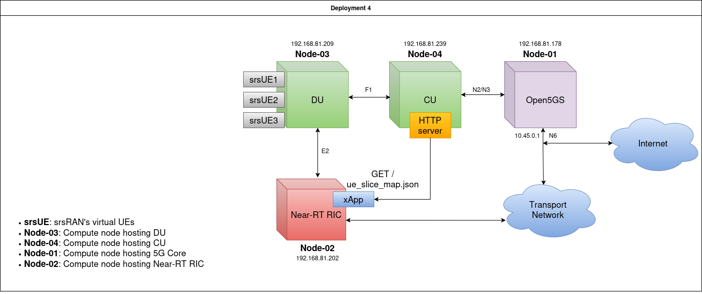

# Running a 20 MHz split CU/DU cell with 6 srsUEs

This guide brings up the testbed used for the 6-UE / 20 MHz experiments:

- an srsRAN Project **CU** and **DU** running as separate processes and linked over F1,
- **6 srsUEs** emulated over ZeroMQ and joined to the single DU by a GNU Radio **multi-UE broker**,
- an **Open5GS** 5G core,
- the **OSC Near-RT RIC**, which the CU and DU connect to over E2 (KPM + RC).



> [!NOTE]
> **Core IP address mismatch:** the diagram above shows the Open5GS core at `192.168.81.178`, which was its previous IP. The core PC has since moved to **`192.168.81.181`**, and that is the address `cu.yml` uses and this guide follows.

---

## 1. Files used

| Component | File |
|---|---|
| CU (CU-CP + CU-UP) | [`gnb_confs/cu.yml`](gnb_confs/cu.yml) |
| DU (ZMQ, band n3, 20 MHz, 106 PRBs) | [`gnb_confs/du_rf_b200_zmq_multi_ue_20mhz.yml`](gnb_confs/du_rf_b200_zmq_multi_ue_20mhz.yml) |
| UEs 1–6 | [`srsue_confs/srsue_20mhz/ue1_zmq.conf`](srsue_confs/srsue_20mhz/) … `ue6_zmq.conf` |
| Multi-UE broker (23.04 MHz) | [`multi-ue-broker_scripts/multi_ue_scenario_headless_6_20mhz.py`](multi-ue-broker_scripts/multi_ue_scenario_headless_6_20mhz.py) |
| Traffic test matrix | [`test_scripts/test_matrix_scripts/run_test_matrix_6ues_with_markers_20mhz.sh`](test_scripts/test_matrix_scripts/run_test_matrix_6ues_with_markers_20mhz.sh) |
| xApp | [`xApps/priority_prb_xapp_test.py`](xApps/priority_prb_xapp_test.py) |

> Use the `srsue_20mhz/` UE configs. The ones in `srsue_10mhz/` are for 52 PRBs at 11.52 MHz and will not sync with this cell.

---

## 2. Network addressing

The configs assume the addresses below. If your hosts use different ones, change them in `cu.yml` and the DU config before you start anything.

| Role | Address | Set in |
|---|---|---|
| AMF (Open5GS, N2) | `192.168.81.181` | `cu.yml` → `cu_cp.amf.addr` |
| CU-CP (N2 + F1-C bind) | `192.168.81.239` | `cu.yml` → `cu_cp.amf.bind_addr`, `cu_cp.f1ap.bind_addr`; DU → `f1ap.cu_cp_addr` |
| CU-UP (F1-U bind) | `192.168.81.240` | `cu.yml` → `cu_up.f1u.socket` |
| DU (F1 + E2 bind) | `192.168.81.209` | DU → `f1ap.bind_addr`, `f1u.socket`, `e2.bind_addr` |
| Near-RT RIC (E2 termination) | `192.168.81.202:36421` | `cu.yml` and DU → `e2.addr` / `e2.port` |
| UE IP pool / iPerf server | `10.45.0.0/16`, gateway `10.45.0.1` | Open5GS SMF/UPF defaults |

Notes:
- The DU, the broker and all 6 srsUEs **must run on the same machine**: they talk over ZMQ on `127.0.0.1`.
- If the CU-CP and CU-UP addresses both live on one host, add the second one as an alias, for example `sudo ip addr add 192.168.81.240/24 dev <iface>`.
- The core PC's IP was changed from `192.168.81.178` (the address shown in `Network_Topologies/Deployment4`) to `192.168.81.181`. Use `.181`, or whatever address your AMF actually listens on, in `cu.yml`.

---

## 3. Prerequisites

Install on the relevant hosts:

| Software | Where | Notes |
|---|---|---|
| [srsRAN Project](https://docs.srsran.com/projects/project/en/latest/user_manuals/source/installation.html) | CU host, DU host | Build with ZMQ: `cmake .. -DENABLE_EXPORT=ON -DENABLE_ZEROMQ=ON` (requires `libzmq3-dev`). Provides `srscu` and `srsdu`. |
| [srsRAN 4G](https://docs.srsran.com/projects/4g/en/latest/general/source/1_installation.html) | DU host | Provides `srsue`. Install `libzmq3-dev` **before** running cmake so the ZMQ RF driver is built. |
| GNU Radio 3.10 with `gr-zeromq` | DU host | `sudo apt install gnuradio` |
| iperf3 | core host and DU host | `sudo apt install iperf3` |
| Open5GS | core host | See [§4](#4-5g-core-open5gs) |
| OSC Near-RT RIC | RIC host | See [§5](#5-near-rt-ric) |

---

## 4. 5G core (Open5GS)

### 4.1 Install

Follow the official quickstart: **<https://open5gs.org/open5gs/docs/guide/01-quickstart/>**

You can also use a Docker deployment of Open5GS instead of the native packages. Whichever you use, the AMF's N2 address must match `cu_cp.amf.addr` in `cu.yml`, and the UPF's N3 (GTP-U) address must be reachable from the CU-UP.

### 4.2 Configure

The cell broadcasts **PLMN 00101, TAC 7** and three slices: **SST 1 (no SD)**, **SST 1 / SD 1** and **SST 1 / SD 2**. The core must accept all of them.

`/etc/open5gs/amf.yaml` (Open5GS 2.7 format, showing only the relevant keys):

```yaml
amf:
  ngap:
    server:
      - address: 192.168.81.181     # must equal cu_cp.amf.addr in cu.yml
  guami:
    - plmn_id: { mcc: 001, mnc: 01 }
      amf_id: { region: 2, set: 1 }
  tai:
    - plmn_id: { mcc: 001, mnc: 01 }
      tac: 7
  plmn_support:
    - plmn_id: { mcc: 001, mnc: 01 }
      s_nssai:
        - sst: 1
        - sst: 1
          sd: 000001
        - sst: 1
          sd: 000002
```

`/etc/open5gs/upf.yaml`: set `upf.gtpu.server.address` to the core's LAN IP (e.g. `192.168.81.181`) so the CU-UP can reach N3.

`/etc/open5gs/nssf.yaml`: add one `nsi` entry for each S-NSSAI above, or sessions on SD 1 / SD 2 will be rejected.

Restart the services you changed:

```bash
sudo systemctl restart open5gs-amfd open5gs-upfd open5gs-nssfd open5gs-smfd
```

### 4.3 Register the 6 subscribers

Add the UEs in the Open5GS WebUI (`http://<core-host>:9999`, default login `admin` / `1423`). All six use **OPc `63bfa50ee6523365ff14c1f45f88737d`**, **AMF `8000`** and **DNN/APN `internet`** (IPv4).

| UE | Namespace | IMSI | K | Suggested S-NSSAI |
|---|---|---|---|---|
| 1 | `ue1` | `001010123456780` | `00112233445566778899aabbccddeeff` | SST 1 (no SD) – best effort |
| 2 | `ue2` | `001010123456790` | `00112233445566778899aabbccddef00` | SST 1 (no SD) – best effort |
| 3 | `ue3` | `001010123456791` | `00112233445566778899aabbccddef01` | SST 1, SD `000001` – medium |
| 4 | `ue4` | `001010123456792` | `00112233445566778899aabbccddef02` | SST 1, SD `000001` – medium |
| 5 | `ue5` | `001010123456793` | `00112233445566778899aabbccddef03` | SST 1, SD `000002` – high |
| 6 | `ue6` | `001010123456794` | `00112233445566778899aabbccddef04` | SST 1, SD `000002` – high |

The slice split is up to you: the test script and the xApp read each UE's actual slice from the slice map. The script does need **at least one UE per priority**.

---

## 5. Near-RT RIC

Install and start the srsRAN fork of the OSC Near-RT RIC by following **<https://github.com/srsran/oran-sc-ric>**:

```bash
git clone https://github.com/srsran/oran-sc-ric
cd oran-sc-ric
docker compose up
```

- The E2 termination must be reachable at the address in `e2.addr` (`192.168.81.202:36421`, SCTP) from both the CU and the DU host.
- Copy the thesis xApps into the folder that is mounted in the `python_xapp_runner` container:

  ```bash
  cp <this-repo>/xApps/*.py oran-sc-ric/xApps/python/
  ```

---

## 6. Bring-up

Start the components **in this order**. Each one connects to the one started before it.

### 6.0 One-time: create the UE network namespaces (DU host)

```bash
for i in 1 2 3 4 5 6; do sudo ip netns add ue$i; done
```

Namespaces are lost on reboot. `sudo ip netns list` shows the ones that exist.

### 6.1 Core and RIC

Make sure Open5GS is running (`systemctl status open5gs-amfd`) and the RIC containers are up (`docker compose ps` in `oran-sc-ric/`).

### 6.2 CU (CU host)

```bash
sudo srscu -c gnb_confs/cu.yml
```

Wait until the CU reports a successful **NG Setup** with the AMF.

### 6.3 DU (DU host)

```bash
sudo srsdu -c gnb_confs/du_rf_b200_zmq_multi_ue_20mhz.yml
```

Wait for **F1 Setup** with the CU and **E2 Setup** with the RIC. The DU then waits for the ZMQ radio, so no samples flow yet.

### 6.4 The 6 srsUEs (DU host, one terminal each)

```bash
sudo srsue srsue_confs/srsue_20mhz/ue1_zmq.conf
sudo srsue srsue_confs/srsue_20mhz/ue2_zmq.conf
sudo srsue srsue_confs/srsue_20mhz/ue3_zmq.conf
sudo srsue srsue_confs/srsue_20mhz/ue4_zmq.conf
sudo srsue srsue_confs/srsue_20mhz/ue5_zmq.conf
sudo srsue srsue_confs/srsue_20mhz/ue6_zmq.conf
```

The UEs block until the broker starts. Each UE writes its log to `/tmp/ueN.log`.

### 6.5 Multi-UE broker (DU host), last

```bash
python3 multi-ue-broker_scripts/multi_ue_scenario_headless_6_20mhz.py
```

The broker connects the DU and the UEs over these ZMQ ports:

| Node | TX port | RX port |
|---|---|---|
| DU | 2000 | 2001 |
| UE *N* (1–6) | 2*N*01 (2101 … 2601) | 2*N*00 (2100 … 2600) |

It copies the DU's downlink to all 6 UEs and adds the 6 uplinks together into the DU. Each UE has a `ueN_path_loss_db` variable (default 0 dB). Press **Enter** in the broker terminal to stop it.

Within a few seconds every UE terminal should show `RRC Connected` and `PDU Session Establishment successful. IP: 10.45.x.x`.

---

## 7. Verify

```bash
# Every UE has an address on its TUN interface
for i in 1 2 3 4 5 6; do echo "ue$i: $(sudo ip netns exec ue$i ip -4 -br addr show tun_srsue)"; done

# Each UE can reach the core gateway
for i in 1 2 3 4 5 6; do sudo ip netns exec ue$i ping -c 2 10.45.0.1; done
```

The UE netmask is `/16`, so `10.45.0.1` can be reached without a route. To reach anything outside that range, add a default route in each namespace:

```bash
sudo ip netns exec ue1 ip route add default via 10.45.1.1 dev tun_srsue
```

The DU's metrics (JSON) are on its WebSocket at port `8001`, and the DU log is in `/tmp/du.log`.

---

## 8. Running experiments

### 8.1 iPerf3 servers (core host)

The test script sends **downlink UDP** (`iperf3 -u -R`) to `10.45.0.1`, using one port per UE:

```bash
for p in 5201 5202 5203 5204 5205 5206; do iperf3 -s -p $p -D; done
```

### 8.2 xApp (RIC host)

The xApp gets each UE's priority from the UE→slice map that the CU host serves over HTTP:

```bash
cd oran-sc-ric
docker compose exec python_xapp_runner ./priority_prb_xapp_test.py \
    --e2_node_id gnbd_001_001_00019b_0 \
    --ue_slice_map_source http://192.168.81.239:8088/ue_slice_map.json \
    --slice_priority_map "1-ffffff=best_effort,1-000001=medium,1-000002=high" \
    --enable_control
```

- Leave out `--enable_control` for **baseline** runs: the xApp then only monitors and logs.
- Add `--csv_log_file <path>` to keep the decision log for the QoS analysis scripts.
- `--e2_node_id` is the DU's E2 node ID. The RIC logs it when the DU connects.

### 8.3 Test matrix (DU host)

The script needs the same slice map saved next to it, and it calls `sudo -n`, so refresh the sudo credentials first:

```bash
cd test_scripts/test_matrix_scripts
curl -s http://192.168.81.239:8088/ue_slice_map.json -o ue_slice_map.json
sudo -v
./run_test_matrix_6ues_with_markers_20mhz.sh
```

The script reads `DURATION` (default 60 s), `SERVER_IP` (default `10.45.0.1`) and `OUT_BASE` (default `./results`) from the environment. It maps `gnb_cu_ue_f1ap_id` 0…5 to namespaces `ue1`…`ue6`, so check in the slice map that the IDs match the UEs you expect. The UEs may attach in a different order from the one you started them in.

After the run, analyse the results with `test_scripts/qos_analysis_scripts/run_qos_analysis_6ues_auto.py`.

---

## 9. Shutdown

Stop in reverse order: test script → xApp → broker (Enter) → srsUEs (Ctrl+C) → DU → CU.

The namespaces can be kept for the next run. To remove them:

```bash
for i in 1 2 3 4 5 6; do sudo ip netns delete ue$i; done
```

---

## 10. Troubleshooting

| Symptom | Likely cause / fix |
|---|---|
| CU: NG Setup fails | `cu_cp.amf.addr` does not match the AMF's NGAP address, or the PLMN/TAC/slices in `amf.yaml` differ from `cu.yml`. |
| DU: F1 Setup never completes | `f1ap.cu_cp_addr` in the DU is not the CU-CP's `f1ap.bind_addr`, or SCTP is blocked between the hosts. |
| DU/CU: E2 Setup fails | The RIC is not running, or `192.168.81.202:36421/sctp` cannot be reached from that host. |
| UEs never find the cell | The broker was started before the DU/UEs, or a UE is using a 10 MHz config. Check that all sample rates are 23.04 MHz and `nof_prb = 106`. |
| Some UEs attach, others drop or never sync | CPU overload: 7 × 23.04 Msps streams is heavy. Close other load, use the `performance` CPU governor, or raise `slow_down_ratio` in the broker. |
| PDU session rejected for SD 1/SD 2 UEs | The slice is missing from `amf.yaml` `plmn_support` or `nssf.yaml`, or the subscriber's S-NSSAI in the WebUI is wrong. |
| UE attached but no data | Check that the UPF's GTP-U address can be reached from the CU-UP (N3), and that the iperf3 servers are running on `10.45.0.1`. |
| `srsue` errors on `netns` | The namespace `ueN` does not exist. Run the commands in step 6.0. |
